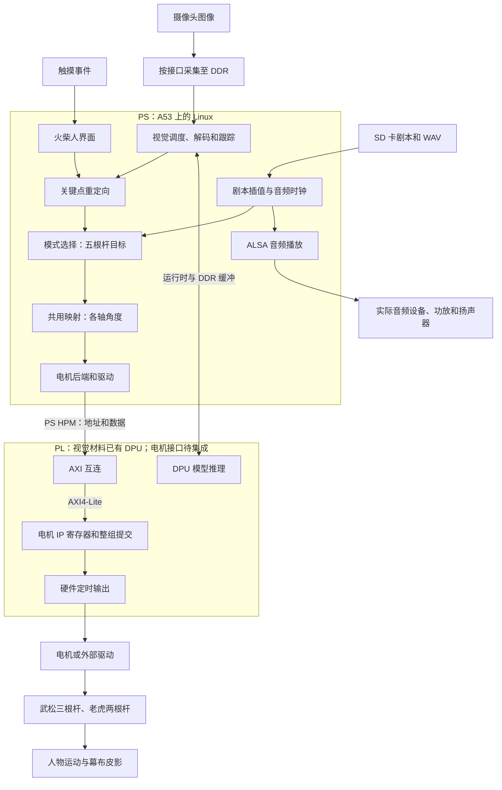

# 武松打虎：三人分工、PS/PL 数据流与实现流程

本文以当前 `shadow_play` v0.3 和队友的 FOLLOW 视觉交接包为软件依据，整理目标系统方案。视觉材料说明了现有采集/推理结构；本次只审阅源代码并补充软件适配，没有现场验证板卡。电机硬件接口未冻结，下面的 PWM 寄存器、驱动和最终板端启动流程仍是待落实的设计。

## 1. 已知范围与实现边界

- 目标主控：Zynq UltraScale+ XCZU4EV。视觉材料标注正点原子 MPSoC-P4 / XCZU4EV，Vivado/Vitis 2022.2、DPU B4096；最终整机硬件版本、原理图、引脚和 BSP 仍应由硬件队友确认。
- 武松：脖子处、左手、右手三根控制杆；老虎：头部耳朵处、尾巴处两根控制杆。
- 五根杆不等于五个电机。当前十轴参数仅用于模拟双轴云台，实际轴数由机构决定。
- 下半身没有独立电机指令，通过连接关节、重力和惯性响应上身动作；效果需要实物调试。
- 工作区现有 `ov5640_zynq7020` Block Design 标明 `xc7z020clg400-2`，可参考结构，不能直接用作 XCZU4EV 的硬件交付。
- 当前总控电机后端为 CSV/JSONL 导出。尚无真实电机 AXI、PWM 驱动、ARM64 总控板端或真实机构验证。
- 视觉 FOLLOW 已有最终九点数组，原交接包没有逐帧控制发送；本版补充 Python 适配和 camera v2 接收，还需接入真实 FOLLOW 联调。
- 触控和摄像头模式当前仅重定向武松，老虎头尾保持中立。需要互动老虎时须增加输入/UI或动作合成。

## 2. 三人的工作及交付

按用户最新明确的分工：你交付 C++ 应用源码、剧本、音频、配置和电脑测试结果；硬件队友（队员一）负责真实电机后端、Vivado/PetaLinux 集成、板端编译和 SD 卡部署；队员二交付视觉/屏幕模块和关键点数据。你配合接口确认和动作调试，不承担板端系统制作。下文对系统全流程的解释用于理解和交接，不代表这些工作全部属于你。

### 队员一：机构、电机、PL、板端系统集成与部署

1. 完成幕布、光源安装、人物关节、五根杆、云台支架、传动与走线；验证腿部惯性动作和杆之间的干涉。
2. 确定电机类型、轴数、驱动、供电、逻辑电平、机械范围和上电初始状态。
3. 逐轴确认 `axis_id`、控制杆、通道、转向、中立角、角度范围和允许速度，并提供角度到驱动量的标定数据。
4. 若用脉宽位置舵机，实现 PL 多路 PWM；若用其他执行器，实现其实际需要的 STEP/DIR、总线或驱动控制接口。
5. 为电机 IP 实现 AXI4-Lite 控制/状态寄存器、整组提交、规定时刻生效、复位默认态和指令超时保护。
6. 在 Vivado 连接 PS、AXI 互连、电机 IP、时钟、复位、中断；合并队员二需要的 PL 模块，完成 XDC、时序检查、bitstream 和 XSA。
7. 提供波形测量结果、寄存器说明、引脚表、硬件版本和最小控制例程，协助 Linux 后端接入。
8. 实现真实 `MotorBackend`，将你的 `angle_deg` 按标定换成执行器命令，完成驱动和 PS/PL 接入。
9. 负责 PetaLinux、设备树、驱动/依赖集成、匹配 SDK、ARM64 编译、SD 卡及板上启动部署；队员二提供其外设和程序的依赖。

**交付结果：已验证的机械系统 + 实测标定表 + 真实电机后端 + Vivado/板端 Linux 工程 + 可运行的 SD 卡和启动方法。**

### 队员二：摄像头、人体识别、触控和显示

1. 确认摄像头实际接口和模组，跑通初始化、曝光/图像格式、采集和驱动。
2. 若摄像头接 PL，提供接收、视频格式转换、帧缓冲/DMA 所需模块与驱动要求，交队员一合并硬件工程。
3. 维护现有 FOLLOW 人体姿态推理、单人跟踪与防抖，输出头、双肩、双肘、双腕、双髋九点；处理裁剪还原、方向、人体左右、无人、遮挡和多人的目标选择。C++ 从双肩中点近似颈部，不要求视觉模型输出不存在的颈部点。
4. 测量目标板端到端帧率和延迟。现有材料使用 PS Python/VART 调度 PL DPU；交付与硬件匹配的模型、DPU 配置、运行时依赖和启动命令。
5. 跑通屏幕显示和触摸输入，完成火柴人拖动界面、关节约束及模式/播放控制按钮。
6. 接入 `integrations/follow/pose_sender.py`，按 `input_protocol.md` 输出 camera v2；触控可继续用 v1。提供真实样本和发送运行说明，验证换人、失踪、进程重启。UI 按钮向总控发送控制命令，不能只改变屏幕上的图标。
7. 配合板端驱动、依赖库和启动集成，提供运行命令及故障状态。

**交付结果：能在目标系统运行的摄像头/识别/触控程序 + 必要的 IP/驱动配置 + 关键点样本和接口说明。**

### 你：剧目、映射、总控源码与资源交付

1. 制作正式 90 秒分镜、旁白、配乐、音效和 WAV；将动作编成五根杆的时间关键帧。
2. 维护 `Script`、音频时钟与同步，处理开始、暂停、恢复、结束、重播。
3. 维护输入协议、FOLLOW 薄适配层、解析、序号/会话/换人检查、模式选择、人体/火柴人到杆目标的重定向。
4. 维护共用映射：标定、角度限位、平滑、限速和逐杆输入超时；与队员一共同标定真实机构。
5. 提供 `MotorBackend` 接口、CSV/JSONL 导出后端及整组电机目标约定；真实硬件后端由硬件队友接入。JSONL 只定义软件交接数据，不等于 PL 已实现的协议。
6. 在自己的 Ubuntu 中编译和模拟测试，把完整源码、CMake 文件、第三方依赖、配置与资源交给硬件队友。
7. 维护日志、录制回放、测试、资源目录和应用版本说明，提供运行参数与资源加载方法。
8. 配合三模式及整场联调，根据实测延迟、幅度和识别效果修改应用与动作资源，整理你的软件设计和交付文档。

**交付结果：C++ 总控源码/CMake/依赖 + FOLLOW Python 薄适配层 + 正式剧本/WAV/配置 + 接口和运行说明 + 电脑测试记录。**

## 3. PS、PL、DDR、SD 卡分别做什么

| 部分 | 本项目建议职责 |
| --- | --- |
| PS | A53 CPU 运行 Linux；执行总控、映射、UI、音频，以及视觉采集调度、DPU 运行时、解码、跟踪和适配 |
| PL | 视觉材料已有采集/显示和 DPU 路径；电机定时输出需要硬件队友集成 |
| DDR | 运行中的程序、视频帧、音频缓冲、关键点和动作状态 |
| SD 卡 | 启动文件、系统、可执行程序、模型、剧本、音频、参数和日志的持久存储 |
| 外部驱动/电源 | 接收控制信号并提供电机运行所需电力 |

PS 与 PL 在同一颗 SoC 内。普通 C++ 应用经 ARM64 编译后由 PS 执行；PL 由 Vivado 生成的配置数据建立硬件逻辑。当前程序不会因为复制到 SD 卡就自动变成 PL 电路。[AMD UG1085](https://docs.amd.com/v/u/en-US/ug1085-zynq-ultrascale-trm)



图像、触摸、音频是否经过 PL 取决于板级接口；电机输出链路是三模式共同使用的部分。

## 4. 数据在软件中如何变化

| 阶段 | 数据及单位 | 处理者 |
| --- | --- | --- |
| 图像采集 | 像素、宽高、格式、帧缓冲 | 队员二及驱动/采集 IP |
| FOLLOW 内部结果 | 正向 1280×720 像素坐标的九点数组及置信度 | 队员二的识别/跟踪程序 |
| 人体/火柴人消息 | 关键点 x/y ∈ [0,1]、confidence、source、seq；camera v2 另含会话和跟踪元数据 | 视觉适配层 / 触控程序 |
| 五根杆 | 每杆 x/y ∈ [-1,1]、valid | 你的 Script 或 Retargeter |
| 电机目标 | N 个轴的 angle_deg，单位度 | 你的 MotionMapper |
| 硬件命令 | 脉宽/计数等定点整数、提交序号 | 硬件队友实现的真实后端 |
| 控制引脚 | 实际电平脉冲或执行器协议 | 队员一 PL/接口模块 |
| 机械输出 | 电机转动、杆运动、人物关节响应 | 实物机构 |

当前共用类型为 `ShadowPose`，内含武松颈部、左手、右手及老虎头（耳部连接）、尾五组目标。规范主杆标识是 `wusong_neck`，旧 `wusong_body` 仅保留解析兼容。映射的初版公式为 `angle = neutral + gain_x*x + gain_y*y`，随后限位、平滑、限速。它是待标定的二维近似，尚未建立云台、杆长、铰链和幕布位置的完整逆运动学。复杂机构可能需要查表或非线性模型。

原始人体坐标左上为原点、y 向下；杆目标舞台右/上为正。左右采用人物自身定义。重定向完成坐标与尺度转换，PL 不解析这些 JSON 字段。

当前本机 UDP 是同一 Linux 系统内的软件进程通信。它与芯片内部 AXI 是两个不同层次的接口。`AxisOutput` 含 C++ 字符串，不能整体当作 AXI 寄存器数据复制。

首选将整个 `ControlTick` 直接交给硬件队友实现的 C++ `MotorBackend::send()`。新增 `--motor-format jsonl` 可导出一周期一组的最终角度，适合交接检查或另行实现的进程接口；并没有让 PL 直接解析 JSON。详见 [视觉接入步骤](vision_to_motor.md) 和 [电机接口](hardware_motor_protocol.md)。

## 5. AXI 在中间具体做什么

### 5.1 三种接口

| 名称 | 作用 | 本项目示例 |
| --- | --- | --- |
| AXI4-Lite | 按地址读写少量控制/状态寄存器 | 更新 PWM 脉宽、使能、提交、读取故障 |
| AXI4 存储映射接口 | 按内存地址执行读写，支持突发传输 | DMA 把视频帧写进 DDR |
| AXI4-Stream | 按握手传输连续数据，不带内存地址阶段 | 摄像头接收模块输出像素流 |

AXI 是硬件协议；JSON 是数据编码；UDP 是软件通信。它们不需要相同的数据格式。[AMD AXI 参考指南 UG1037](https://www.amd.com/content/dam/xilinx/support/documents/ip_documentation/axi_ref_guide/latest/ug1037-vivado-axi-reference-guide.pdf)

### 5.2 PS 向 PL 下发电机目标

```text
PS C++：AxisOutput.angle_deg
 → MotorBackend：按标定换成整数脉宽/计数
 → Linux 驱动，或配置好的 UIO 映射
 → PS M_AXI_HPM0_FPD
 → AXI SmartConnect/Interconnect
 → 电机 IP 的 AXI4-Lite 从接口
 → 内部目标寄存器
 → 整组生效
 → PWM 引脚
```

可用的 PS 主接口还包括 `M_AXI_HPM1_FPD`、`M_AXI_HPM0_LPD`。这里的 M 表示 PS 发起地址事务；控制 IP 响应。具体使用哪个端口由 Vivado 设计确定。[AMD PG201 接口表](https://docs.amd.com/r/en-US/pg201-zynq-ultrascale-plus-processing-system/Slave-Interface)

寄存器可以理解为有地址的小存储单元。PS 对 `BASE + 某轴偏移` 写入计数值，互连根据地址选中 PWM IP，IP 保存该值。BASE 和偏移必须来自真实地址分配和寄存器表。

AXI4-Lite 的一次写操作包含写地址 AW、写数据 W 和写响应 B；读操作包含读地址 AR 和读数据/响应 R。每条通道按 VALID/READY 握手，写地址与写数据并不保证同周期到达。自定义 IP 需要正确处理握手和背压。

Linux 应用通过驱动暴露的接口访问硬件。UIO 方案可通过设备映射访问寄存器；不能把未经映射的物理地址直接当成普通 C++ 指针。具体寄存器映射、访问顺序、屏障和资源管理由驱动/后端一起确定。[Linux UIO 文档](https://www.kernel.org/doc/html/latest/driver-api/uio-howto.html)

### 5.3 建议的电机寄存器协议（尚未实现）

| 寄存器用途 | 含义 |
| --- | --- |
| `ENABLE` | 输出使能，复位默认行为需定义 |
| `PERIOD_TICKS` | 实际执行器需要的周期计数 |
| `PULSE_TICKS[N]` | 本组各轴的高电平计数，仅适用相应脉宽执行器 |
| `COMMIT_SEQ` | 全部目标写完，提交这一组 |
| `APPLIED_SEQ` | PL 已应用哪一组参数 |
| `STATUS/FAULT` | 状态、错误和超时 |
| `WATCHDOG` | 过久没有新有效命令时的处理参数 |

PS 先写待生效的一整组目标，再提交；PL 在约定周期边界一次切换。避免一部分轴用上一帧、另一部分轴用下一帧。待生效缓冲占用、重复提交和跨时钟握手也必须定义。跨时钟不能仅靠将多位数据逐位同步来保证整组一致。

`APPLIED_SEQ` 只代表硬件接收/应用命令，不代表真实电机已到位。需要位置反馈时，另接编码器/驱动反馈并定义返回接口。

PL 独立产生脉冲边沿；C++ 当前默认每 20 ms 更新目标。应用更新周期与执行器 PWM 周期是两个独立配置，不能因为前者是 20 ms 就认定所有电机都使用 50 Hz。

### 5.4 图像为什么走另一条 AXI 路

如果相机接 PL，候选结构是：

```text
相机接收模块
 → AXI4-Stream 像素流
 → VDMA S2MM 写通道或兼容的帧缓冲模块
 → AXI4 内存写事务
 → PS S_AXI_HP0_FPD 等端口
 → DDR 帧缓冲
 → Linux 采集驱动
 → PS 姿态识别程序
```

PL 中 DMA 是事务发起者，PS 的 `S_AXI_HP0..3_FPD` / `S_AXI_HPC0..1_FPD` 是入口，方向与前面 PS 通过 HPM 访问 PWM 相反。VDMA 另有 AXI4-Lite 控制口，供 PS 设置帧地址、分辨率和步长。DMA/VDMA负责搬运，人体识别由推理程序或另行实现的加速器完成。[AMD PG020 VDMA](https://docs.amd.com/r/en-US/pg020_axi_vdma/Overview)

DMA 帧缓冲须配套 Linux 驱动、内存分配、帧完成通知与缓存一致性处理。连接 HPC 并不自动解决所有缓存问题；不能假设接好 Vivado 线后 OpenCV 就能直接读取任意 DDR 地址。[Linux DMA 指南](https://www.kernel.org/doc/html/latest/core-api/dma-api-howto.html)

## 6. 三个任务分别怎样运行

### 任务一：90 秒自动武松打虎

输入是你编好的关键帧 JSON 和 WAV。程序按照音频已播放的位置在相邻关键帧之间插值；不会自动从台词识别动作。

武松：

```text
SD 卡剧本 → PS 读取/插值
 → 颈部、左手、右手三根杆的目标
 → 共用映射得到相应各轴角度
 → 电机后端 → HPM/AXI4-Lite → PL 对应通道
 → 三个云台/机构 → 三根杆 → 武松动作
```

老虎：

```text
同一剧本、同一播放时间
 → 头部耳朵处、尾巴处两根杆的目标
 → 同一映射和整组输出
 → 电机后端 → HPM/AXI4-Lite → PL 对应通道
 → 两个云台/机构 → 头尾控制杆 → 老虎动作
```

两角色的 N 个轴应同组提交，减少动作相互错位。下半身响应来自被动关节、重力和惯性，你需要通过颈部主杆动作与节奏去调出踢腿/摆腿效果。

音频同时走：`SD WAV → PS/DDR 音频缓冲 → ALSA/声卡驱动 → 实际音频接口 → codec/DAC/功放/扬声器`。USB 音频或板载/PL I²S 的具体链路取决于硬件。ALSA 软件后端已写，板载设备尚未验证。

音频进度提供演出时钟，PL 保证脉冲定时，机构仍有响应延迟。打击音与动作真正对齐需实测，并调整动作提前量或音效位置。

### 任务二：触控火柴人

```text
手指触摸
 → 触摸控制器（实际可能 USB/I²C 等）
 → Linux 输入驱动
 → 队员二 GUI 更新火柴人的关节坐标
 → touch 关键点帧
 → 同进程调用或同机 UDP
 → 你的总控接收、校验和重定向
 → 武松三杆目标
 → 共用映射 → 电机后端 → HPM/AXI4-Lite → PL
 → 武松云台、控制杆、皮影
```

触控可提供 `neck`，没有该点时由双肩中点近似颈部位置来控制颈部主杆；左手腕与同侧肩的相对位置对应左手杆；右手腕与同侧肩对应右手杆，手的幅度按肩宽归一化。骨盆不再驱动颈部主杆。

显示本身是另一条支路：`GUI 画面 → 显示缓冲 → 实际 DP/HDMI/LCD 控制器 → 屏幕`。画面像素和触摸坐标不是一组信号，需分别跑通。

**本版老虎保持中立。**若任务二要求同时手控老虎，需要增加头尾控件和协议/角色合成；若要求自动陪练，需要你增加老虎动作层。不能从只有人体关节的消息中推断出已实现的老虎控制。

若屏幕自带独立处理器，应通过实际串口/网络接口传输相同语义的数据；当前仅绑定回环地址的 UDP 不能直接接远端设备。

### 任务三：摄像头人体姿态控制武松

视觉交接包的当前路线为全帧采集、180° 旋转、缩放/补边、DPU 推理、九点解码、单人跟踪和防抖。Python 运行在 PS Linux，DPU 推理由 PL 加速；不是让你的 C++ 重新处理原始视频。具体传感器和底层采集接口由队友的硬件设计确定，不能套用旧 XC7Z020 示例。

```text
图像 → PS 预处理/VART 调度 PL DPU → 解码、跟踪、防抖
 → 正向 1280×720 九点 pose
 → Python 薄适配：归一化、无效点处理、camera v2 消息
 → 本机 UDP → C++ 检查来源/序号/会话/人物/有效性
 → Retargeter：双肩中点近似颈部、双腕相对同侧肩
 → 武松颈部、左右手三杆目标
 → MotionMapper 输出各轴 angle_deg
 → 后端、驱动、HPM、AXI4-Lite
 → PL 定时输出
 → 武松机构和皮影动作
```

当前老虎仍保持中立。失去某个有效关键点时，对应杆不刷新最后有效时间；超过默认 0.30 s 后限速回中。这个软件策略只有总控继续运行才有效，进程卡死后的处理需要 PL watchdog。

FOLLOW 模型没有直接的颈部关键点，也没有 3D 深度；双肩中点只是颈部杆控制的近似参考。v2 保留 `session_id/track_id/captured_s/detected`：会话或协议改变会锁定并要求 `stop → reset-inputs → camera`；当前 camera 模式检测到换人时停止，确认人物后用 `camera` 重新启用。发送时间只作诊断，超时仍按 C++ 本地接收时间计算。

原交接包没有将最终点逐帧发送给总控，本版 Python 适配需接到 `pose = stabilizer.update(...)` 之后。`YOLO_STATUS` 是低频运行日志，不能代替动作帧。现有材料中的帧率记录不等于本次完成了板端性能测试。

## 7. 跟踪一次左手抬起的数据

假设已归一化的关键点：左肩 `(0.60,0.40)`，右肩 `(0.40,0.40)`，左腕 `(0.60,0.20)`，置信度足够，镜像关闭。

1. 肩宽为 `0.20`，默认手部缩放为两倍肩宽，即 `0.40`。
2. 左手杆目标为 `x=0`、`y=(0.40-0.20)/0.40=0.50`。
3. 当前模拟左手俯仰轴 `neutral=90°`、`gain_y=30°`，得到目标 `105°`。
4. 总控平滑、限速，输出角度逐步接近 `105°`。
5. 以下仅举例假设某舵机已标定 `0°→1000 μs`、`180°→2000 μs`：稳定后的 `105°` 对应约 `1583 μs`。真实设备必须用实测表，不照抄该范围。
6. 后端把脉宽换成 PWM IP 规定的整数计数，经 AXI 写入左手对应通道，并与其他轴一起提交。
7. PL 在约定时刻应用该组参数，按硬件时钟输出脉冲；舵机及杆带动武松左手。

因此，数据依次是：像素/屏幕点 → 关键点坐标 → 杆的运动目标 → 角度 → 脉宽计数 → 引脚电平 → 机械运动。

若电机是普通直流电机，PWM 占空比本身不代表位置；若是步进或总线舵机，末段应按真实协议重做。电机电源/驱动承担动力，PL I/O 提供匹配电平的控制信号。

## 8. Ubuntu、Vivado、CMake、PetaLinux 各在哪一步使用

| 工具 | 运行位置及用途 | 交付物 |
| --- | --- | --- |
| VS Code | 电脑编辑源码/配置/文档 | `.cpp/.hpp/.json` 等源文件 |
| Ubuntu | 电脑开发环境，运行编译、测试和支持的 PetaLinux 工具 | 开发环境；与板端 Linux 分开 |
| CMake | 组织 C++ 构建规则，选择编译器和依赖 | 构建目录/构建规则 |
| GCC/G++、Ninja | 真正编译链接及调度构建任务 | 当前 CPU 架构的可执行程序 |
| Vivado | 设计/连接/仿真/综合/实现 PS-PL 硬件 | IP、XDC、bitstream、XSA |
| PetaLinux Tools | 在支持的主机系统构建板端 Linux、设备树、根文件系统、驱动与 SDK | 系统镜像、启动文件、SDK |
| PetaLinux SDK | 匹配目标系统的交叉编译器、头文件和库 | 可在目标板运行的 ARM64 应用 |
| Vitis（按需要） | 裸机例程、处理器调试、相关软件平台工作 | 测试程序/调试结果；普通 Linux 应用可使用 SDK+CMake |

电脑本机编译用于仿真；交叉编译用于板端。CMake 不是编译器，也不负责把普通 C++ 变成 PL。交叉编译时使用匹配 SDK 的环境、工具链和 sysroot。[CMake 工具链说明](https://cmake.org/cmake/help/latest/manual/cmake-toolchains.7.html)

## 9. 从工程到 SD 卡，再到上电演出

### 开发阶段

1. 三人确定板卡/执行器/相机/屏幕/音频接口、工具版本和三份协议：关键点、杆/轴标定、电机寄存器。
2. 你在电脑跑通三种模拟输入；队员一独立验证电机波形和单轴机构；队员二独立验证关键点、显示和触摸。
3. 队员一合并 Vivado 硬件，检查时钟、复位、约束与地址，生成 bitstream，并导出硬件描述 XSA。[AMD 硬件平台流程](https://docs.amd.com/r/2023.2-English/ug1393-vitis-application-acceleration/Creating-a-hardware-platform)
4. 硬件队友使用匹配版本的 PetaLinux 导入该硬件描述，补齐设备树/驱动/依赖库，构建板端系统。版本不同可能使用 XSA 或由其生成的系统设备树流程，命令按实际版本确定。[AMD 硬件导入说明](https://docs.amd.com/r/2023.2-English/ug1144-petalinux-tools-reference-guide/Importing-a-Hardware-Configuration)
5. 硬件队友从该系统工程生成并安装 SDK，使用 SDK+CMake 编译你交付的总控源码及队员二的识别、GUI 程序，或将程序纳入对应 PetaLinux recipe。目标系统也要有运行时依赖。[AMD SDK 构建说明](https://docs.amd.com/r/2023.2-English/ug1144-petalinux-tools-reference-guide/Building-SDK)
6. 硬件队友按实际启动方案制作 SD 卡：启动分区、根文件系统/数据分区、应用和资源目录；设置启动脚本、权限和日志。你提供资源、配置和运行说明。

### 文件含义

| 文件/目录 | 用途 |
| --- | --- |
| `.bit` 等 PL 配置文件 | 建立 PL 硬件逻辑 |
| `.xsa` | 开发工具间交接硬件结构、地址等信息，可按导出选项包含 bitstream |
| `BOOT.BIN` | 启动组件的打包文件；内容按工程配置，如 FSBL、PMU 固件、TF-A、U-Boot及可选 PL 配置 |
| `image.ub` 或 `Image`/DTB 等 | Linux 内核及相关启动描述；是否含根文件系统按打包方式 |
| rootfs | 板端 Linux 的程序、库、驱动模块与配置 |
| ARM64 可执行程序 | PS 上运行的总控、识别、GUI |
| JSON/CSV/WAV/模型文件 | 应用加载的资源 |

实际镜像名称、启动脚本和分区布局由你们的 BSP/版本决定，不应仅凭文件名照抄其他板卡。使用持久应用目录时，修改应用/资源通常只更新相应文件；硬件或驱动变化则需要同步相关配置和系统组件。

上述启动组件及 SD 卡部署的依据见 [AMD 启动镜像说明](https://docs.amd.com/r/2023.2-English/ug1144-petalinux-tools-reference-guide/Generate-Boot-Image?contentId=Z3lqdk~riYdy2ehU4a2CTA) 和 [AMD SD 卡启动说明](https://docs.amd.com/r/2023.2-English/ug1144-petalinux-tools-reference-guide/Booting-a-PetaLinux-Image-on-Hardware-with-SD-Card?contentId=ZXmC8ZFOT5_5Jd_hhG7zVw)。这些链接以 2023.2 为流程参考，不表示已替你们确定工具版本。

### 上电运行阶段

1. 板卡按启动模式从 SD 等介质启动，加载引导程序并初始化 PS/DDR。
2. 按方案在启动阶段或 Linux 中加载正确的 PL 配置；应用访问 PL 前确认配置就绪。
3. Linux 启动、挂载根文件系统，加载设备树描述的设备及驱动。
4. 总控读取配置，识别电机接口版本和状态，执行已定义的初始化/归位流程。
5. 启动 GUI/识别程序；检查输入、音频、控制通道后进入待机。
6. 操作者选择模式；选中的输入变成五杆目标，共用映射后定期下发。
7. PL 连续生成实际控制波形；角色随机构运动，音频按选中的演出任务播放。
8. 结束/停止按定义回中；异常按应用与硬件两级策略处理。停止 PWM、保持位置和切断动力不是同一种行为，需结合机构确认。

### 建议验收顺序

电脑仿真 → 板上驱动/寄存器读写 → 示波器测 PWM → 单轴低速标定 → 武松三杆 → 老虎两杆 → 自动双角色 → 触控 → 体感 → 实际音频同步 → 三模式切换/异常 → 连续多轮 90 秒演出 → 断电重启和 SD 卡定版。

最后交付应包含硬件、系统、应用、资源四类版本及复现步骤。现有轨迹图和通过的软件测试只证明电脑侧相应逻辑，不替代上面的实物验收。
